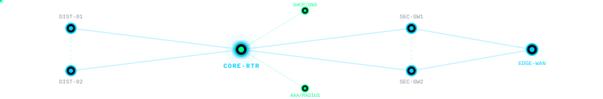

<div align="center">

<!-- Animated Header Wave Banner -->


<!-- Dynamic Animated Typing Terminal -->
<a href="https://github.com/abdulwahabsaim">
  
</a>
<br/>
<!-- Live Animated Dual-Theme Topology -->

<br/>
<br/>
<br/>

<!-- Real-Time Telemetry Badges -->
<p align="center">
  <a href="https://abdulwahabsaim.github.io/#credentials" title="Verify CCNA Credential"></a>
  
  
  
</p>

</div>


## 📌 About Me & Value Proposition

* 🎓 **Academic Profile:** Final-year **Bachelor of Science in Computer Science** student specializing in enterprise networking, routing protocols, and systems administration.
* 📜 **Industry Certification:** **Cisco Certified Network Associate (CCNA 200-301)**.
* 🏆 **Flagship Capstone Project:** Architected, configured, and verified a 15-device multi-tier hierarchical campus network ([`cisco-enterprise-campus-mega-lab`](https://github.com/abdulwahabsaim/cisco-enterprise-campus-mega-lab), based on Jeremy's IT Lab CCNA Mega Lab), featuring a wire-speed Layer 3 Core, Active-Active HSRPv2, deterministic Rapid-PVST+ root alignment, OSPFv2 Area 0, Layer 2 Security (DAI/DHCP Snooping/Port-Security), Cisco 3504 WLC mobility, and IPv6 dual-stack.
* 🎯 **Career Goal:** Seeking **Junior Network Engineer**, **NOC Engineer (Level 1/2)**, or **Network Operations Specialist** roles at enterprise NOCs, MSPs, ISPs, or datacenters.
* 🛠️ **Engineering Mindset:** Bridging **Computer Science scripting** (Python, Scapy, Linux) with **production network infrastructure** (OSPF, EIGRP, HSRP, 802.1Q, Port Security, Wireless, NAT/PAT).


## 🗂️ Featured Network Engineering Repositories

<div align="center">

| Node / Repository | Focus Domains | Core Protocols & Architecture | Verification Highlights | Live Link |
| :--- | :--- | :--- | :--- | :---: |
|  | **Enterprise Campus Capstone (15 Nodes)** | **Hierarchical 3-Tier Campus • Wire-Speed L3 Core • Active-Active HSRPv2 • OSPFv2 Area 0 • Dual-ISP Floating WAN • DAI & DHCP Snooping • Cisco 3504 WLC • IPv6 Dual-Stack** | • 100% Packet Tracer Assessment Score<br/>• 0% inter-switch trunk hairpinning<br/>• 10-Slide High-Res Architecture Deck | [**`cisco-enterprise-campus-mega-lab` →**](https://github.com/abdulwahabsaim/cisco-enterprise-campus-mega-lab) |
|  | **Enterprise Routing & High Availability (13 Labs)** | **EIGRP AS 7 • Multi-Area OSPF • HSRP v2 • 5-Node WAN Mesh (ECMP) • Multi-Hop Static • Floating Static • QoS • GRE** | • ABR Type-3 Inter-Area LSAs<br/>• Dual-segment active/standby failover<br/>• Symmetrical multi-path transit RIB | [**`enterprise-routing-labs` →**](https://github.com/abdulwahabsaim/enterprise-routing-labs) |
|  | **Switching Infrastructure & Campus Hardening (13 Labs)** | **STP Root Guard • Loop Guard • Port Security • Extended ACLs • 802.1Q VTP • EtherChannel • DAI • Voice VLAN** | • Rogue Root Bridge hijack defense (`ROOT_Inc`)<br/>• Dynamic, Static & Sticky MAC limits<br/>• Unidirectional link loop mitigation | [**`layer2-security-labs` →**](https://github.com/abdulwahabsaim/layer2-security-labs) |
|  | **Core Application-Layer Services & Mobility (5 Labs)** | **DHCP (D.O.R.A) • DHCP Relay • Authoritative DNS • Stratum 5 NTP • Syslog Telemetry • Cisco WLC** | • End-to-end client lifecycle workflow<br/>• Option 43 / Option 150 provisioning<br/>• SIEM-ready microsecond timestamps | [**`network-services-labs` →**](https://github.com/abdulwahabsaim/network-services-labs) |

</div>


## 🚀 Complete Hands-On Lab Inventory (32 Production Labs)

```text
├── 🏆 cisco-enterprise-campus-mega-lab/
│   ├── configs/
│   ├── slides/
│   ├── docs/
│   └── CCNA Mega Lab (Jeremy_s IT Lab).pka
│
├── 📁 enterprise-routing-labs/
│   ├── 01-dynamic-routing-eigrp/
│   ├── 02-dynamic-routing-multi-area-ospf/
│   ├── 03-multi-router-wan-mesh-ecmp/
│   ├── 04-multi-hop-static-routing/
│   ├── 05-hsrp-gateway-redundancy/
│   ├── 06-intervlan-routing-multilayer-svi/
│   ├── 07-floating-static-routes-wan-failover/
│   ├── 08-ospf-neighbor-troubleshooting-lsdb/
│   ├── 09-ipv6-dual-stack-routing-slaac/
│   ├── 10-enterprise-edge-nat-pat-overload/
│   ├── 11-modular-qos-traffic-prioritization/
│   ├── 12-site-to-site-gre-tunnel-ospf/
│   └── 13-dynamic-routing-eigrp-variance/
│
├── 📁 layer2-security-labs/
│   ├── 01-access-control-lists-acl/
│   ├── 02-vlan-trunking-and-vtp/
│   ├── 03-port-security-mac-limiting/
│   ├── 04-stp-root-guard/
│   ├── 05-stp-bpdu-filtering-and-loop-guard/
│   ├── 06-etherchannel-lacp-pagp-layer3/
│   ├── 07-cdp-lldp-discovery-and-hardening/
│   ├── 08-secure-device-management-sshv2/
│   ├── 09-switchport-voice-vlan-telephony/
│   ├── 10-dhcp-snooping-and-dynamic-arp-dai/
│   ├── 11-stp-hsrp-active-root-alignment/
│   ├── 12-vtp-modes-and-dtp-hardening/
│   └── 13-enterprise-extended-acls-service-filtering/
│
└── 📁 network-services-labs/
    ├── 01-core-network-services-dhcp-dns-http/
    ├── 02-centralized-dhcp-relay-ip-helper/
    ├── 03-ntp-stratum-hierarchy-authentication/
    ├── 04-centralized-syslog-telemetry/
    └── 05-enterprise-wlc-centralized-wireless/
```


## 🧰 Technical Skills & Protocol Matrix

<div align="center">

### 🌐 Routing, Switching & Campus Security
<p align="center">
  
  
  
  
  
  
  
  
  
  
  
  
  
  
</p>

### 🐧 Systems, Observability & Network Tools
<p align="center">
  
</p>
<p align="center">
  
  
  
  
</p>

### 💻 Computer Science & Software Development
<p align="center">
  
</p>

</div>


## 📊 Telemetry & Contribution Activity

<div align="center">


</div>


## 📬 Terminal Contact Endpoints
<div align="center">

[](https://abdulwahabsaim.github.io)
[](https://www.linkedin.com/in/abdulwahabsaim/)
[](mailto:abdulwahabsaim58.nl@gmail.com)

<br/>


</div>
