<a href="https://abdulwahabsaim.github.io">
  <picture>
    <source media="(prefers-color-scheme: dark)" srcset="assets/header-dark.svg">
    
  </picture>
</a>

  
  
  
  

  
  
  
  

<picture><source media="(prefers-color-scheme: dark)" srcset="assets/divider-dark.svg"></picture>

CCNA-certified Junior Network Engineer with 3.5 years of Computer Science foundations, available full-time immediately.

I build enterprise topologies in Packet Tracer, GNS3 and EVE-NG, configure every device from the Cisco IOS CLI and keep the configs and runbooks here in Git. Looking for junior network, NOC and infrastructure roles across the Netherlands. Shifts and on-call are fine.

  

<picture><source media="(prefers-color-scheme: dark)" srcset="assets/divider-dark.svg"></picture>

## Labs

32 documented Cisco labs, plus Cisco ASA firewall labs added lesson by lesson. Each one follows the same path: plan the addressing, build the topology, configure from the CLI, verify with show and debug output, then commit the configs and a runbook.

  <a href="https://github.com/abdulwahabsaim/cisco-enterprise-campus-mega-lab"><picture><source media="(prefers-color-scheme: dark)" srcset="assets/card-campus-dark.svg"></picture></a>

- HSRPv2 active gateways aligned with Rapid-PVST+ root bridges
- Multi-area OSPFv2 with floating static failover to a second ISP
- DHCP Snooping, DAI and Port Security at the access layer, plus Cisco 3504 WLC wireless

The flagship scenario is the CCNA Mega Lab by Jeremy's IT Lab. Every configuration, verification test, addressing plan and slide is my own work.

  <a href="https://github.com/abdulwahabsaim/enterprise-routing-labs"><picture><source media="(prefers-color-scheme: dark)" srcset="assets/card-routing-dark.svg"></picture></a>
  <a href="https://github.com/abdulwahabsaim/layer2-security-labs"><picture><source media="(prefers-color-scheme: dark)" srcset="assets/card-security-dark.svg"></picture></a>
  <a href="https://github.com/abdulwahabsaim/network-services-labs"><picture><source media="(prefers-color-scheme: dark)" srcset="assets/card-services-dark.svg"></picture></a>
  <a href="https://github.com/abdulwahabsaim/cisco-asa-firewall-labs"><picture><source media="(prefers-color-scheme: dark)" srcset="assets/card-firewall-dark.svg"></picture></a>

Every lab also has its own page with a redrawn topology on the [portfolio](https://abdulwahabsaim.github.io/labs/).

<picture><source media="(prefers-color-scheme: dark)" srcset="assets/divider-dark.svg"></picture>

## Credentials

| Credential | Issuer | Date | |
| :--- | :--- | :--- | :--- |
| **Cisco Certified Network Associate** (CCNA 200-301) | Cisco | Feb 2026 | [Verify](https://cp.certmetrics.com/cisco/en/public/verify/credential/852d6536dadd4375ac8964bdbd599b94) |
| **Administer Active Directory Domain Services** | Microsoft Applied Skills | Nov 2026 | [Verify](https://learn.microsoft.com/en-us/users/abdulwahabsaim/credentials/79c096475bfb39a0) |
| **Get started with identities and access using Microsoft Entra** | Microsoft Applied Skills | Nov 2026 | [Verify](https://learn.microsoft.com/en-us/users/abdulwahabsaim/credentials/f6ba56b7933690ed) |
| **Jira Service Management Fundamentals with AI** | Atlassian Credentialed | Nov 2026 | [Verify](https://cp.certmetrics.com/atlassian/en/public/verify/credential/eb1ebbd08f3b4f5797091b9240db1176) |

Training at Corvit: Red Hat System Administration (RHCSA) coursework completed. Taking Cisco CCNP and Cisco ASA/FTD firewall classes now.

<picture><source media="(prefers-color-scheme: dark)" srcset="assets/divider-dark.svg"></picture>

## What I work with

Orange marks the skills I use most.

**Routing and switching** 

**Security** 

**Services and operations** 

**Systems** 

<picture><source media="(prefers-color-scheme: dark)" srcset="assets/divider-dark.svg"></picture>

## Background

- **IT and systems assistant**, eezyprint (part-time, family business), 2022 - 2024. Looked after the production PCs, printers and scanners of a wholesale print press: LAN printing, drivers, Windows installs.
- **Personal lab and peer support**, 2022 - now. 50+ clean OS installs, re-images and dual-boots across 20+ machines, hardware upgrades and Wi-Fi bridging.
- **BS Computer Science (7 of 8 Semesters Completed)**, University of Central Punjab, 2022 - 2026.

 

  

Based in Goes, Zeeland and open to relocating within the Netherlands.

