<a href="https://abdulwahabsaim.github.io">
  <picture>
    <source media="(prefers-color-scheme: dark)" srcset="assets/header-dark.svg">
    
  </picture>
</a>

  
  
  
  

CCNA-certified Junior Network Engineer with 3.5 years of Computer Science foundations, available full-time immediately.

I build enterprise topologies in Packet Tracer, GNS3 and EVE-NG, configure every device from the Cisco IOS CLI and keep the configs and runbooks here in Git. Looking for junior network, NOC and infrastructure roles across the Netherlands. Shifts and on-call are fine.

## Flagship: enterprise campus network

<a href="https://github.com/abdulwahabsaim/cisco-enterprise-campus-mega-lab">
  <picture>
    <source media="(prefers-color-scheme: dark)" srcset="assets/campus-topology-dark.svg">
    
  </picture>
</a>

Two office blocks, a routed Layer 3 core and a dual-ISP edge across 15 Cisco devices.

- HSRPv2 active gateways aligned with Rapid-PVST+ root bridges
- Multi-area OSPFv2 with floating static failover to a second ISP
- DHCP Snooping, DAI and Port Security at the access layer, plus Cisco 3504 WLC wireless

The scenario is the CCNA Mega Lab by Jeremy's IT Lab. Every configuration, verification test, addressing plan and slide is my own work. [Open the repository](https://github.com/abdulwahabsaim/cisco-enterprise-campus-mega-lab)

## Lab repositories

32 documented Cisco labs, plus Cisco ASA firewall labs added lesson by lesson. Each one follows the same path: plan the addressing, build the topology, configure from the CLI, verify with show and debug output, then commit the configs and a runbook.

| Repository | Labs | What is inside |
| :--- | :---: | :--- |
| [**cisco-enterprise-campus-mega-lab**](https://github.com/abdulwahabsaim/cisco-enterprise-campus-mega-lab) | 1 | 15-device campus, 13 device configs, addressing plan and a 10-slide architecture deck |
| [**enterprise-routing-labs**](https://github.com/abdulwahabsaim/enterprise-routing-labs) | 13 | OSPF and EIGRP, static and floating static, HSRP, NAT and PAT, QoS, GRE and IPv6 |
| [**layer2-security-labs**](https://github.com/abdulwahabsaim/layer2-security-labs) | 13 | VLANs and VTP, STP guards, EtherChannel, Port Security, DHCP Snooping, DAI, ACLs and SSHv2 |
| [**network-services-labs**](https://github.com/abdulwahabsaim/network-services-labs) | 5 | DHCP relay, DNS, NTP with authentication, Syslog and Cisco 3504 WLC wireless |
| [**cisco-asa-firewall-labs**](https://github.com/abdulwahabsaim/cisco-asa-firewall-labs) | 3 | Cisco ASA in EVE-NG: security levels, ACLs and object groups, NAT, PAT and DMZ publishing. In progress |

Every lab has its own page with a redrawn topology on the [portfolio](https://abdulwahabsaim.github.io/labs/).

## Credentials

| Credential | Issuer | Date | |
| :--- | :--- | :--- | :--- |
| **Cisco Certified Network Associate** (CCNA 200-301) | Cisco | Feb 2026 | [Verify](https://cp.certmetrics.com/cisco/en/public/verify/credential/852d6536dadd4375ac8964bdbd599b94) |
| **Administer Active Directory Domain Services** | Microsoft Applied Skills | Nov 2026 | [Verify](https://learn.microsoft.com/en-us/users/abdulwahabsaim/credentials/79c096475bfb39a0) |
| **Get started with identities and access using Microsoft Entra** | Microsoft Applied Skills | Nov 2026 | [Verify](https://learn.microsoft.com/en-us/users/abdulwahabsaim/credentials/f6ba56b7933690ed) |
| **Jira Service Management Fundamentals with AI** | Atlassian Credentialed | Nov 2026 | [Verify](https://cp.certmetrics.com/atlassian/en/public/verify/credential/eb1ebbd08f3b4f5797091b9240db1176) |

Training at Corvit: Red Hat System Administration (RHCSA) coursework completed. Taking Cisco CCNP and Cisco ASA/FTD firewall classes now.

## What I work with

| Area | Skills |
| :--- | :--- |
| Routing and switching | **Cisco IOS CLI**, **multi-area OSPFv2**, **HSRPv2**, **VLANs and 802.1Q**, STP and Rapid-PVST+, EtherChannel (LACP, PAgP), EIGRP, static and floating static, IPv4 and IPv6 subnetting |
| Security | **DHCP Snooping**, **Dynamic ARP Inspection**, **Port Security**, standard and extended ACLs, SSHv2 device hardening, NAT and PAT, Cisco ASA (in training) |
| Services and operations | **DHCP relay**, **Syslog**, NTP, DNS, Cisco 3504 WLC, Jira Service Management, Git and Markdown runbooks |
| Systems | **Ubuntu Linux (daily)**, **Windows 10/11 imaging**, Active Directory DS, Microsoft Entra ID, Microsoft 365, QEMU/KVM, VMware, VirtualBox |

## Background

- **IT and systems assistant**, eezyprint (part-time, family business), 2022 - 2024. Looked after the production PCs, printers and scanners of a wholesale print press: LAN printing, drivers, Windows installs.
- **Personal lab and peer support**, 2022 - now. 50+ clean OS installs, re-images and dual-boots across 20+ machines, hardware upgrades and Wi-Fi bridging.
- **BS Computer Science (7 of 8 Semesters Completed)**, University of Central Punjab, 2022 - 2026.

---

Based in Goes, Zeeland and open to relocating within the Netherlands. The quickest way to reach me is [email](mailto:abdulwahabsaim58.nl@gmail.com) or [LinkedIn](https://www.linkedin.com/in/abdulwahabsaim/).
